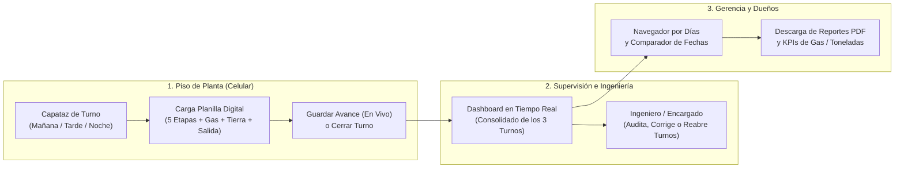

# Manual Oficial de Usuario y Operación — Sistema de Control de Producción Cerámica

Este manual describe el funcionamiento integral del sistema **CERÁMICA PRODUCCIÓN ERP**, diseñado para operar en **teléfonos celulares (PWA), tablets, notebooks y computadoras de escritorio**, detallando el paso a paso para cada uno de los roles de la empresa.

---

## 1. Visión General del Flujo Operativo

---

## 2. Perfiles y Roles del Sistema (Alcances y Permisos)

El sistema cuenta con **4 niveles de acceso (RBAC)** diseñados para proteger la integridad de los datos de planta:

| Rol | Destinatario en la Empresa | Qué puede ver y hacer |
| :--- | :--- | :--- |
| **1. Capataz de Turno (`CAPATAZ`)** | Jefes de Turno Mañana, Tarde y Noche | Accede directamente a la **Planilla Digital de Producción** desde el celular. Carga cantidades de bancos, zorras, tipo de ladrillo, gas, viajes de tierra y salida de material. Puede **Guardar Avance (En Vivo)** durante su turno y **Cerrar Turno** al finalizar. |
| **2. Ingeniero / Encargado (`INGENIERO_ENCARGADO`)** | Jefe de Planta e Ingenieros de Producción | Visualiza el **Dashboard en Tiempo Real**, navega por todos los días históricos, compara fechas, administra el **Catálogo de Ladrillos**, y tiene permiso especial para **Auditar, Editar o Reabrir un turno cerrado** si un capataz cometió un error. |
| **3. Directorio / Dueños (`DIRECTORIO`)** | Socios, Dueños y Gerencia | Acceso ejecutivo en tiempo real al **Dashboard de Planta**, **Navegador por Días**, **Estadísticas y Comparativas** y **Descarga de Reportes PDF**. Es un rol de consulta segura (evita modificaciones accidentales de datos operativos). |
| **4. Administrador General (`ADMIN`)** | Responsable de Sistemas / Administración General | Acceso total a todos los módulos anteriores + módulo exclusivo de **Gestión de Usuarios y Roles** (alta/baja de personal, cambio de contraseñas y asignación de turnos). |

---

## 3. Instalación en el Celular (PWA) y Activación de Huella Digital

El sistema está construido como una **Aplicación Web Progresiva (PWA)** con soporte biométrico (**WebAuthn / Passkeys**).

### Paso a paso para instalar la App y activar la Huella (Todos los usuarios):
1. Abrir la dirección del sistema desde el navegador del celular (**Chrome** en Android o **Safari** en iPhone).
2. Iniciar sesión por primera vez con su **Usuario y Contraseña**.
3. En el menú lateral (tocando el ícono `☰` arriba a la izquierda en el celular):
   - Tocar **"Instalar App en Celular (PWA)"** (o *"Agregar a pantalla de inicio"* en el navegador). Esto creará el ícono de **Cerámica Prod** en la pantalla del teléfono como una aplicación nativa a pantalla completa.
4. Para activar el ingreso con huella:
   - En el menú lateral, tocar el botón **"Acceso con Huella"**.
   - Presionar el botón verde **"Activar Huella Digital Ahora"**.
   - El teléfono pedirá apoyar el dedo en el sensor de huella (o reconocimiento facial).
5. **¡Listo!** A partir de ese momento, cada vez que abra la aplicación desde su celular, solo deberá tocar el botón **"Ingresar con Huella Digital"** en la pantalla principal e ingresará en menos de 1 segundo sin escribir contraseñas.

---

## 4. Manual Paso a Paso por Rol

---

### ROL A: Capataz de Turno (`CAPATAZ`)

Al ingresar, el sistema lo lleva directamente a la pantalla **Planilla Operativa Móvil (`/capataz`)**, que replica los colores y sectores exactos de la planilla tradicional de fábrica.

#### Paso 1: Verificar Fecha, Turno y Responsable
* En la parte superior se muestra la **Fecha Operativa** (por defecto el día de hoy) y los 3 botones de turno: **`MAÑANA`**, **`TARDE`** y **`NOCHE`**.
* El sistema selecciona automáticamente el turno habitual del capataz e indica su estado:
  - `Sin iniciar`: Aún no se cargaron datos en ese turno.
  - `● En Curso`: El turno se está cargando en vivo.
  - `✓ Cerrado`: El turno ya fue finalizado.

#### Paso 2: Cargar las 5 Etapas del Proceso Productivo
Cada etapa está identificada con su franja de color reglamentaria:
1. **EXTRUSORA (Franja Verde):**
   - Ingresar la **Cantidad de Bancos** usando el teclado numérico o los botones rápidos `-`, `+` y `+5`.
   - Seleccionar el **Ladrillo** en el desplegable (ej. `H12 — Hueco 12x18x33`). El sistema mostrará automáticamente a cuántos ladrillos equivale.
2. **SECADERO (Franja Amarilla):**
   - Ingresar la **Cantidad de Banco** ingresados a secadero y seleccionar el **Ladrillo**.
3. **CARGA DE BANCO (Franja Marrón):**
   - Completar la fila **MANUAL** (bancos cargados manualmente + tipo de ladrillo).
   - Completar la fila **ROBOT** (bancos cargados por el robot + tipo de ladrillo).
4. **HORNO (Franja Roja):**
   - Completar **ZORRAS CARGADAS** (zorras que entraron al horno + tipo de ladrillo).
   - Completar **ZORRAS FUERA** (zorras cocidas que salieron del horno + tipo de ladrillo).
5. **DESCARGA (Franja Gris):**
   - Completar **CANTIDAD DE ZORRAS** descargadas/empaquetadas y el **Ladrillo**.

> **¿Qué hacer si a mitad del turno se cambió el molde y se fabricaron 2 tipos de ladrillo distintos?**
> Debajo de cada etapa hay un botón **`+ Agregar otro tipo de ladrillo en...`**. Al tocarlo, se abre un segundo renglón dentro de esa misma etapa para cargar la cantidad y medida del segundo ladrillo.

#### Paso 3: Cargar Salida de Material, Consumo de Gas y Viajes de Tierra
En el bloque lateral/inferior de la planilla:
* **SALIDA MATERIAL:** Ingresar las **Toneladas** despachadas en el turno.
* **CONSUMO DE GAS:** Ingresar la lectura/consumo de gas ($\text{m}^3$) correspondiente a su turno (el recuadro muestra además lo cargado en los otros turnos y el total acumulado del día).
* **VIAJES TIERRA:** Registrar con los botones `-` y `+` la cantidad de **Viajes Negra** y **Viajes Roja**.
* **Observaciones:** Anotar cualquier novedad mecánica, parada o cambio de boquilla.

#### Paso 4: Guardar Avance en Vivo vs. Cerrar Turno
En la barra fija inferior el capataz dispone de dos botones:
* **Botón Amarillo `Guardar Avance (En Vivo)`:** Guarda todos los datos cargados hasta el momento sin bloquear la planilla. Permite que el capataz cargue datos a mitad del turno y que el Encargado o los Dueños ya los vean reflejados en tiempo real.
* **Botón Verde `Cerrar Turno Finalizado`:** Se utiliza al terminar las 8 horas del turno. Pide confirmación y deja el parte cerrado con sello de fecha y hora. (Una vez cerrado, el capataz no puede alterarlo salvo que el Encargado/Ingeniero lo reabra).

---

### ROL B: Dueños / Directorio (`DIRECTORIO`)

Al ingresar, el sistema presenta el **Centro de Control de Producción (`/dashboard`)**.

#### 1. Monitoreo en Tiempo Real (`/dashboard`)
* **Indicador `Tiempo Real`:** En la esquina superior izquierda indica cuántos de los 3 turnos del día ya fueron registrados (ej. `2/3 turnos registrados`) y actualiza la pantalla automáticamente cada 15 segundos.
* **6 Tarjetas Resumen del Día:** Muestran de un vistazo el total diario de:
  1. **Extrusora** (bancos y equivalencia en miles de ladrillos).
  2. **Secadero** (bancos).
  3. **Carga de Banco** (desglosando Robot vs. Manual).
  4. **Horno** (zorras fuera cocidas, zorras cargadas y toneladas cocidas estimadas).
  5. **Descarga y Salida** (zorras descargadas y toneladas despachadas).
  6. **Gas y Tierra** ($\text{m}^3$ totales del día y viajes de tierra negra/roja).
* **Planilla Consolidada de los 3 Turnos:** Muestra una tabla comparativa con las columnas **Turno Mañana**, **Turno Tarde**, **Turno Noche** y **Total Día**, junto con el nombre del capataz de cada turno y sus observaciones.

#### 2. Navegar a través de Distintos Días (Máquina del Tiempo)
* En la barra superior puede:
  - Tocar cualquiera de los botones rápidos de los últimos días (ej. `Vie 06/11`, `Sáb 07/11`, `Dom 08/11`...).
  - Usar las flechas **`◀` (Día Anterior)** y **`▶` (Día Siguiente)**.
  - O tocar el ícono de **Calendario** para saltar a cualquier fecha de meses anteriores.
* Al cambiar de día, toda la pantalla recalcula instantáneamente los 3 turnos y totales de esa fecha.

#### 3. Exportar Reporte Diario en PDF
* Tocando el botón naranja **`Exportar PDF`** arriba a la derecha, se descarga automáticamente un documento PDF A4 apaisado (`produccion-ceramica-AAAA-MM-DD.pdf`) con el cuadro completo de los 3 turnos, capataces, etapas, gas, viajes de tierra y toneladas, listo para imprimir o compartir por WhatsApp.

#### 4. Estadísticas y Comparativas entre Fechas (`/estadisticas`)
Accediendo desde el menú lateral a **`Comparativas y PDF`**:
* **Filtro por Rango de Fechas (`Desde` / `Hasta`):** Calcula los acumulados de una semana, quincena o mes completo.
* **KPIs de Ingeniería:**
  - Total de ladrillos extruidos en el período.
  - Porcentaje de uso del **Robot** frente a carga **Manual**.
  - **Rendimiento Térmico:** Cuántos $\text{m}^3$ de gas se consumieron por cada zorra cocida y por cada tonelada salida del horno.
* **Comparador Directo entre Dos Fechas (Día A vs. Día B):** Permite elegir dos días específicos en los desplegables y muestra tarjeta por tarjeta la diferencia exacta (`+` en verde si subió la producción, `-` en rojo si bajó).

---

### ROL C: Ingeniero / Encargado de Planta (`INGENIERO_ENCARGADO`)

Posee todas las herramientas de visualización y reportes de **Directorio**, más funciones operativas de supervisión:

1. **Auditar o Corregir cualquier Turno:**
   - En el **Dashboard en Vivo (`/dashboard`)**, debajo de cada tarjeta de turno (Mañana, Tarde, Noche) verá el botón **`Auditar / Editar Turno`** (o **`Cargar Turno`** si el capataz estuvo ausente).
   - Al pulsarlo, abre la planilla de ese turno con permisos de edición.
2. **Reabrir un Turno Cerrado:**
   - Si un capataz cerró su turno por error o olvidó anotar un viaje de tierra, el Encargado entra al turno y pulsa el botón **`Reabrir Turno`**. El estado vuelve a `En Curso` para que pueda corregirse.
3. **Administrar el Catálogo de Ladrillos (`/catalogo`):**
   - Permite dar de alta nuevos modelos de ladrillo o ajustar cuántas unidades entran por banco/zorra y cuánto pesa cada ladrillo, manteniendo exactos los cálculos de toneladas de la planta.

---

### ROL D: Administrador General (`ADMIN`)

Además de tener acceso completo a todos los módulos anteriores, dispone del módulo **`Usuarios y Roles (`/usuarios`)`**:

1. **Crear Nuevos Usuarios:**
   - Pulsar **`+ Nuevo Usuario`**, completar Nombre, Usuario, Correo, Contraseña inicial, seleccionar el **Rol** (`Capataz`, `Ingeniero / Encargado`, `Directorio` o `Administrador`) y su **Turno Predeterminado** (`Mañana`, `Tarde` o `Noche`).
2. **Cambiar Roles, Turnos o Contraseñas:**
   - Si un capataz rota del Turno Mañana al Turno Noche, el Administrador pulsa **`Editar`** en su fila, cambia su *Turno Predeterminado* a `NOCHE` y guarda.
3. **Suspender Accesos:**
   - Desmarcando la casilla *"Usuario habilitado"*, se bloquea inmediatamente el ingreso de ese usuario (tanto por contraseña como por huella digital) sin perder el historial de los partes que cargó en el pasado.

